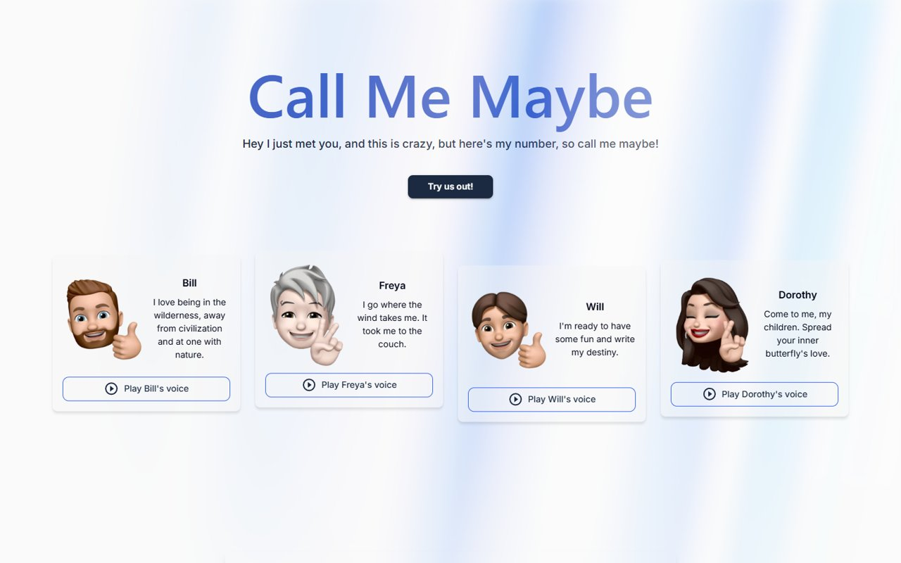

# HackThe6ix 2024

Check out the devpost for this project [**here.**](https://devpost.com/software/688069/joins/57MtJEiPUX857mvloMZ_Kg)

## Web version on Cloudflare

**Try it:** https://danieldombrovsky.com/call-me-maybe (direct link: https://ai-voice-caller.pages.dev)



`web/` is a version of the app that runs on Cloudflare Pages instead of the Python server and Firebase. You describe what the call should say, pick a voice and a tone, and it phones the number for you:

- OpenAI writes the message from your prompt, ElevenLabs turns it into speech, and Twilio places the call and plays the audio.
- Generated audio is kept in an R2 bucket that deletes it after a day.
- Calls are limited to 15 a day and 50 a week across the whole site, counted in Workers KV.

Running it locally needs Node 22. Put `OPENAI_API_KEY`, `ELEVEN_LABS_API_KEY`, `TWILIO_ACCOUNT_SID`, `TWILIO_AUTH_TOKEN` and `TWILIO_PHONE_NUMBER` in `web/.dev.vars`, then:

```
cd web
npm install
npm run dev        # the page, http://localhost:3000
npm run dev:cf     # in a second terminal: the functions on :8788, proxying the page
```

To publish, run `npm run deploy` from `web/`. The same five keys are set as secrets on the Cloudflare Pages project.
